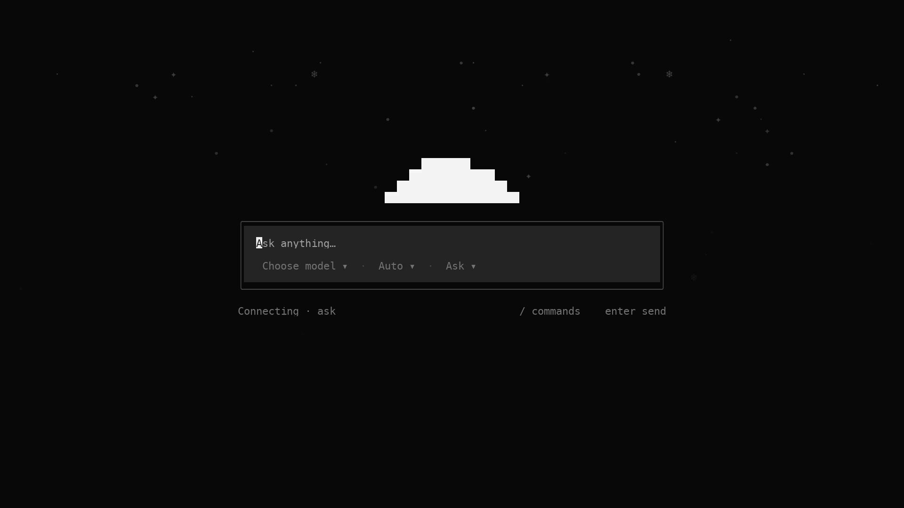

<h1 align='center'>
  Postal
</h1>

<p align="center">
  <b>An open-source alternative AI coding agent that lives in your terminal.</b><br />
  Plans, edits, runs, and reviews code with any model on OpenRouter.
</p>

<p align="center">
  <a href="assets/postalnewdemo.mp4"></a>
</p>

Postal reads and edits your code, runs commands, and delegates tasks to specialized sub-agents. Choose your model through OpenRouter and control which actions need approval.

## Quick Start

Requires Python 3.11+ and Node.js 22+.

```bash
pip install postalcli
postal login    # connect your OpenRouter account
postal          # start in your project directory
```

## Usage

Describe what you want to do: explore a codebase, fix a bug, plan a change, or review your work.

```bash
postal "Find the cause of this failing test and fix it"
postal --continue        # resume your last session in this directory
postal --cwd /path       # work in a different directory
```

Inside the terminal, use `/help` for commands, `/model <name>` to switch models, and `/config` to view your settings.

## Documentation

See the [documentation](docs/README.md) for detailed guides and references:

- [CLI and keyboard shortcuts](docs/cli.md) · [Slash commands](docs/slash-commands.md)
- [Configuration](docs/configuration.md) · [Approval policies](docs/approvals.md)
- [Tools, sub-agents, and MCP](docs/tools.md) · [Sessions and checkpoints](docs/sessions.md)
- [Architecture](docs/architecture.md) · [Technologies](docs/technologies.md)

## Contributing

See [CONTRIBUTING.md](CONTRIBUTING.md) to get started, or [open an issue](https://github.com/andrefetch/postal/issues) with a bug report or idea.

## License

[GNU General Public License v3.0](LICENSE)
